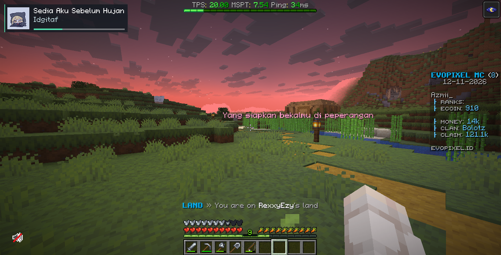

# AMusicMod

Client-side music HUD and floating 3D lyrics for **Minecraft 26.2 / Fabric / Java 25+**.



*In-game preview supplied by Ayzmi. The latest version uses a smaller HUD.*

- Spotify desktop and browser media controls on Windows.
- Local **MP3, WAV and OGG Vorbis** playback, streamed in the background.
- Album covers, synchronized LRC lyrics, customizable text colors, size and distance.

## Use

Install Fabric API and the mod JAR. Join a world, then press **F7** for the music menu.

| Key | Action |
| --- | --- |
| F7 | Music library and appearance settings |
| F8 | Toggle HUD and lyrics |
| `]` | Play / pause |
| `[` | Previous |
| `\` | Next |

Put local music in `.minecraft/amusicmod/music/`, then click **Refresh**. **Music folder** opens the correct instance folder. MP3 title/artist/album tags and embedded covers are read automatically; otherwise use `Artist - Title.mp3`. Matching `.lrc` and `.png`/`.jpg` files take priority. `cover.jpg`, `cover.png` and `folder.jpg` are also supported. No cover available? The compact HUD shows a small music note.

Local lyrics use a matching timed `.lrc` first, then [LRCLIB](https://lrclib.net) when **Online lyrics** is enabled. Lookup sends song title, artist, album and duration, including metadata from local files. Disable it for offline-only use. Missing/incorrect metadata or unavailable timed lyrics can prevent a match; plain audio files do not inherently contain synchronized lyrics. Local playback pauses when leaving a world.

For external music, start playback in Spotify or your browser and choose **Windows auto**, **Spotify desktop** or **Browser media** in the menu. This does not repair playback errors inside Spotify itself. Optional Spotify Web API login is configured with `backend: "spotify"`, your `clientId`, and redirect URI `http://127.0.0.1:48721/callback` in `config/amusicmod.json`.

Press **F7 → Appearance** for colors, lyric size/distance/timing, HUD scale and local volume. Changes save automatically to `config/amusicmod.json`.

## Build

```powershell
.\gradlew.bat build
```

Use `build/libs/amusicmod-1.4.0.jar`. Successful builds remove older AMusicMod JARs from `build/libs`; failed builds keep them. Replace the old JAR in your Minecraft `mods` folder manually.

## Credits

Code: Ayzmi, MIT. Floating lyric design reference: [DangoMusic](https://github.com/Sorihiko/DangoMusic); independently implemented. MP3 decoding: JLayer (LGPL-2.1, bundled license and source link). Icon: user-supplied artwork with the KusArt watermark; artwork is not covered by the code license.
